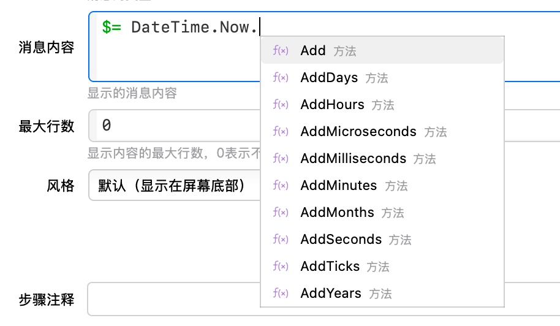
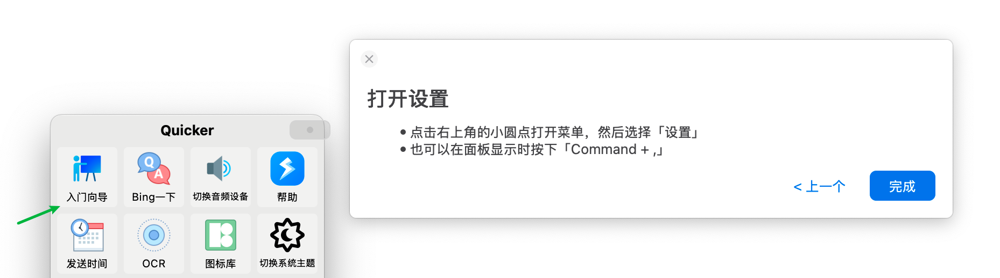

## 第一次使用

:::info[温馨提示]
若您首次下载安装，请您先点击下方的安装方法。

[card:安装方法](../install/index.md)
:::

## 下载

| 平台 | 芯片 | 软件包 |
| --- | --- | --- |
| 🍎 Mac | Apple 芯片（arm） | [Quicker社区 C2027.6.3 arm.aar](https://cdn.quicker.space/Quicker%E7%A4%BE%E5%8C%BAC2027.6.3%20arm.aar) |
| 🍎 Mac | Intel 芯片（intel） | [Quicker社区 C2027.6.3 intel.aar](https://cdn.quicker.space/Quicker%E7%A4%BE%E5%8C%BAC2027.6.3%20intel.aar) |
| 🐧 Linux X11 | arm64 | [Quicker社区 C2027.6.3 Linux arm64.AppImage](https://cdn.quicker.space/quicker-ce-C2027.6.3-linux-arm64.AppImage) |
| 🐧 Linux X11 | x86_64 | [Quicker社区 C2027.6.3 Linux x86_64.AppImage](https://cdn.quicker.space/quicker-ce-C2027.6.3-linux-x86_64.AppImage) |

若遇到问题，您可以加入 [QQ群](https://getquicker.net/KC/Kb/Article/904) 找一下 @🌍-学习

## 2027.6.3

（发布时间：2026 年 11 月 22 日晚）

（🍎 代表适用 macOS 版，🐧 代表适用 Linux X11 版）

1. （🍎🐧）代码编辑器自动补全重做：输入 `$=` C# 表达式、`@=` 的 Python 表达式或 `{变量}` 时都会弹出候选，带类型图标和说明；补全结果较慢时会显示加载提示。




1. （🍎🐧）子程序右键菜单里的「重命名」「修改描述」合并为「修改子程序信息」，可同时修改名称、说明和唯一标识（支持一键重新生成）；修改唯一标识后主要用于解除从其他动作复制来的链接。


2. （🍎🐧）「入门向导」新增「设置」介绍页，介绍通过右上角小圆点菜单或快捷键打开设置



3. （🐧）系统亮暗模式无法自动识别的 Linux 桌面，可在「设置 - 配置杂项」中开启「在面板右上角菜单中显示手动切换亮暗模式」，之后从面板右上角菜单手动切换
4. （🐧）修复退出程序时可能被系统认为软件异常退出而产生提示的问题
5. （🍎🐧）修复窗口位置选择「自定义位置」时窗口不显示的问题（例如「用户选择」模块）
6. （🍎🐧）修复模块没有可显示的输出参数时，步骤编辑器仍然显示空白「输出到变量」区域的问题
7. （🍎🐧）修复高分屏（Retina）下列表图标可能模糊的问题
8.  （🐧）修复深色模式下动作编辑器背景色不对的问题

## 2027.6.2

（发布时间：2026 年 11 月 19 日晚）

（🍎 代表适用 macOS 版，🐧 代表适用 Linux X11 版）

1. （🍎🐧）修复步骤编辑器里模块「控制界面元素」模块，窗口可能报错或被缩到最窄、内容被挤压的问题
2. （🐧）打开「组合动作编辑器」和「设置」窗口时，会尝试主动把窗口带到前台

## 2027.6.1

（发布时间：2026 年 11 月 18 日晚）

:::note[公告]
Quicker 社区版 文档站，现已正式从语雀迁移到本站。<br>
本文档站的运行离不开 CL 的支持！

新用户的预装「帮助」动作打开的网址已改为：

```
https://community-docs.getquicker.net/release-notes/
```

这个网址是一个跳转地址，访问时会自动跳转最新的版本链接。
:::

（🐧 代表适用 Linux X11 版，🍎 代表 macOS 版）

1. （🍎）此前为 macOS 27 的恢复焦点设置，现在对于 macOS 27 用户为<u>总是开</u>，以确保动作正常使用，27 以前系统不受影响，若有问题可加群联系🌍
2. （🐧）Linux x86_64 架构下，最低 GLIBC 版本下降到 2.28（此前为 2.31，其他平台或架构要求不变）
3. （🐧）移除不可用的「扩展热键」功能（较难稳定实现，暂时移除）
4. （🐧）修复使用轮盘时，热键（如右键）会被传递给前台程序的问题
5. （🐧）修复文本指令使用触发键（如空格）触发时，漏删字母的问题
6. （🍎🐧）文本指令支持运行动作
7. 修复使用「等待按键」模块时可能导致闪退的问题
8. （🍎）修复文本窗口必定无法朗读的问题
9. （🍎🐧）文本窗口行数从1开头（原来是从0开始）
10. (🍎🐧) 组合动作编辑器 编辑变量时，若状态变量有值，将显示「查看已保存的值」


11.（🍎🐧）改进「面板动作」右键菜单中的「删除动作状态数据」


您现在可以选择删除部分状态的变量，或在删除前查看状态变量保存的内容。


## 2027.6.0

（发布时间：2026 年 11 月 13 日左右）

本版本开始，尝试开始支持 Linux X11 桌面，提供首个安装包。


